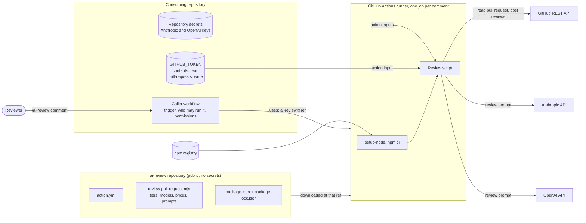
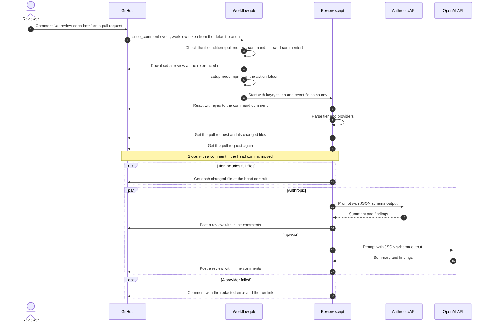
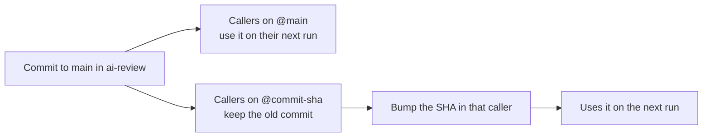

# Architecture

`ai-review` is a composite GitHub Action. A repository that wants reviews adds a short caller workflow and two secrets. This repository holds all the review logic and no secrets.

## Components

| Lives in | Holds |
|---|---|
| This repository | `action.yml`, the review script and its pinned dependencies |
| Each consuming repository | The caller workflow, the provider API keys, and the job's token permissions |

The script reads only environment variables: GitHub's default runner variables, plus the ones `action.yml` sets from its inputs and from the `issue_comment` event. It never checks out or runs pull request code. It reads diffs and files as text through the GitHub API.

## One review run

Providers run in parallel and post separately, so one failing doesn't block the other. If any provider fails, the job also fails.

## Review tiers

The comment picks a tier and providers. If the comment names none, the action uses the `default-tier` and `default-providers` inputs.

| Tier | Focus | Context sent |
|---|---|---|
| `light` | Bugs, logic, contracts | Diff only, smallest size budget |
| `standard` | Bugs, logic, contracts | Diff plus the full changed files |
| `deep` | Bugs, logic, contracts, with stronger models | Diff plus the full changed files, largest size budget |
| `security` | Exploitable vulnerabilities, each with an attack path | Diff plus the full changed files, largest size budget |

Each tier's models, reasoning effort, size budget and per-token prices live in `REVIEW_TIERS` in `review-pull-request.mjs`.

## Building the prompt

- The prompt starts with the pull request's title, branches and description, followed by each changed file's diff with new-file line numbers.
- Lockfiles, minified files and source maps are skipped, as are files GitHub returns no diff for (binary or very large files).
- Diffs are added in order, as long as each still fits the tier's size budget. Full file contents, fetched at the head commit, fill whatever budget is left.
- Every skipped file is listed in the review under "Not reviewed", with the reason.
- The system prompt tells the model to treat pull request content as data and to ignore instructions inside it.

## Posting results

- A finding on a line that appears in the diff becomes an inline comment on that line.
- Any other finding is listed in the review body under "Findings outside the diff".
- If GitHub rejects the inline comments, the review is posted again with every finding in the body.
- The review footer shows the model, effort, file counts, token usage, an estimated cost and a link to the run.

## Security and data

- **Secrets** stay in each consuming repository. They reach the script only as environment variables. Before error text is written to logs or comments, the script redacts key values, GitHub tokens and account IDs (OpenAI org and project IDs, and UUIDs).
- **Token scope** is set by the caller's `permissions` block. The script can read and comment on that repository's pull requests and nothing else.
- **Who can trigger** is decided by the caller's `if` condition. `issue_comment` workflows always run from the default branch, so a pull request can't change its own gate or the action ref.
- **Where code goes:** the pull request's text, diffs and changed files are sent to the selected providers. OpenAI requests set `store: false`.
- **Version trust:** whoever can push to the ref a caller uses controls code that runs with that caller's keys and token. Pin a commit SHA where that matters.

## Versions and changing models

To change a model, edit its entry in `REVIEW_TIERS`, including `model`, `displayName` and both prices. Then commit to `main`. Check the provider's model page for the model ID and pricing.
